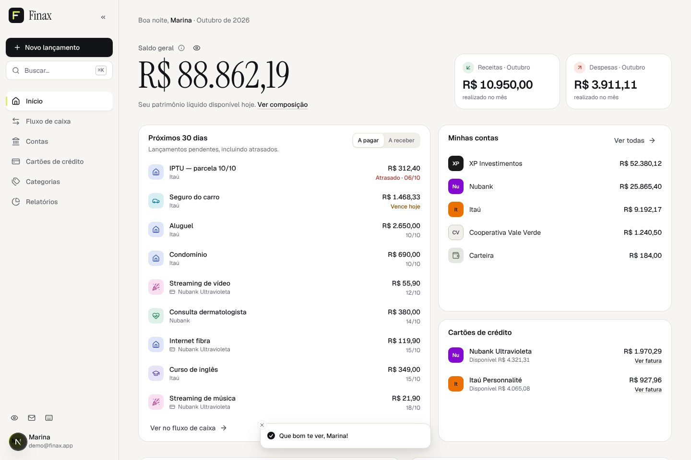
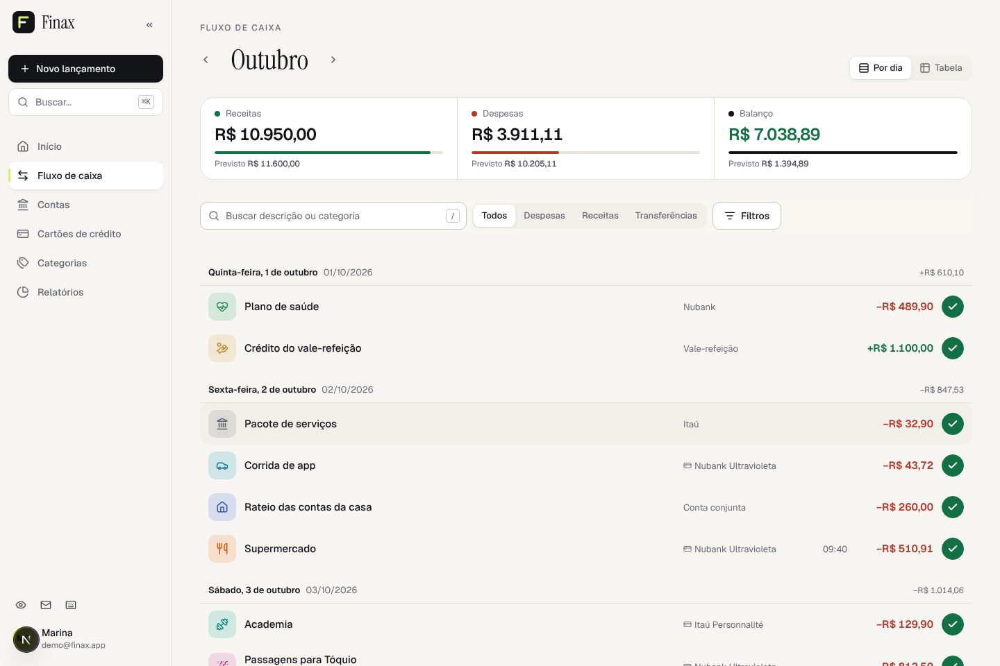
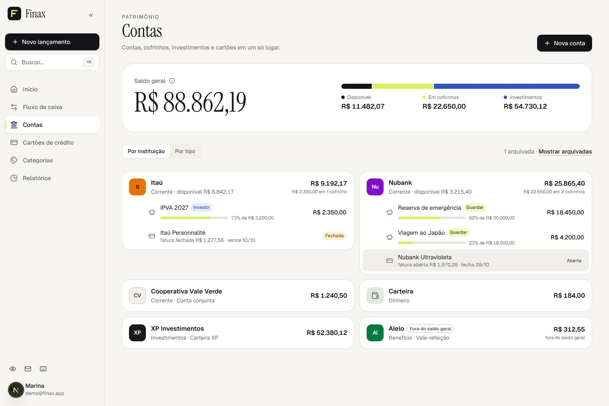
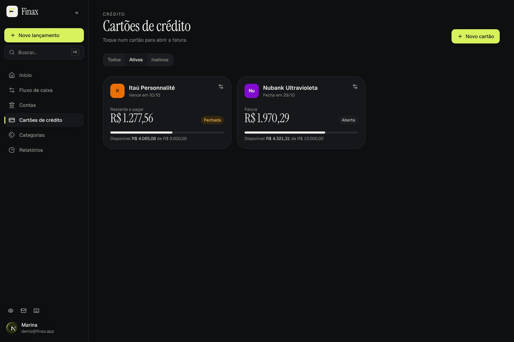

# Finax — protótipo

Protótipo funcional de um SaaS de finanças pessoais, reconstruído do zero a partir da
especificação funcional do Finax. Mantém a cobertura funcional do sistema de referência
(rotas, fluxos, regras e estados) com identidade visual, navegação e arquitetura próprias.
Roda inteiro no navegador, sem backend.

```bash
pnpm install
pnpm dev            # http://localhost:3000
```

Na tela de login, **“Usar conta de demonstração”** preenche `demo@finax.app` / `Finax@2026`.
Essa conta já vem com 12 meses de histórico e 6 meses de previsões. Uma conta nova criada em
`/nova-conta` começa vazia, para testar a primeira configuração (fluxo F6).

| Início | Fluxo de caixa |
| --- | --- |
|  |  |
|  |  |

Celular: [docs/screenshots/mobile.jpg](docs/screenshots/mobile.jpg).

| Script | O que faz |
| --- | --- |
| `pnpm dev` / `pnpm build` / `pnpm start` | Next.js |
| `pnpm test` | Vitest: regras de domínio, backend simulado, componentes e fluxos |
| `pnpm typecheck` | `tsc --noEmit` |
| `pnpm lint` | ESLint (regras do Next e do React Compiler) |

## Stack

Next.js 16 (App Router) · React 19 · TypeScript estrito · Tailwind CSS 4 · Radix UI
(primitivas no estilo shadcn/ui, escritas no projeto) · Motion · Lucide · React Hook Form + Zod ·
TanStack Query · TanStack Table + TanStack Virtual · Apache ECharts (tree-shaken, renderer SVG) ·
Zustand · date-fns. Bibliotecas adicionadas por motivo técnico:

- **cmdk**: paleta de comandos e seletores pesquisáveis.
- **vaul**: gaveta inferior acessível no celular.
- **sonner**: mensagens ao usuário (toasts).
- **geist** e **@fontsource/instrument-serif**: fontes locais, sem depender de rede no build.
- **axe-core** e **playwright** (dev): auditoria de acessibilidade e checagem visual.

## Arquitetura

```
src/
  app/                 rotas (App Router): (public)/… e (app)/… com guarda de sessão
  domain/              tipos e regras puras (totais do mês, ciclos de cartão, filtros, senha…)
  data/
    api.ts             camada de acesso a dados: a única coisa que a UI conhece
    server/            backend simulado: banco local, seed, motor de faturas, endpoints
  features/<domínio>/  telas, diálogos e hooks de cada domínio (contas, cartões, faturas…)
  components/ui        primitivas acessíveis (botão, modal adaptativo, select, picker…)
  components/shared    peças de apresentação (Money, logos, estados de conteúdo, gráficos)
```

- **Camada de dados substituível.** `src/data/api.ts` segue o contrato REST da especificação
  (§8). Trocar o backend simulado por HTTP de verdade só exige mudar esse arquivo. Cada
  chamada simula latência e pode simular falhas.
- **Backend simulado com regras de servidor.** `data/server/` calcula tudo o que a
  especificação marca como “servidor decide”: saldos, saldo geral, grupos de conta, ciclos e
  status de fatura, quitação (inclusive por fatura posterior), limite disponível, `PAID_INVOICE`,
  `INVOICE_HAS_PAYMENT`, reembolsos, séries e parcelas. As escritas são transacionais: rodam
  numa cópia e só são gravadas se não houver erro. O estado fica em `localStorage`, com um
  conjunto de dados separado por usuário.
- **Sincronização entre telas (§5.12).** Todos os dados financeiros ficam sob a chave de
  consulta `["fin"]`. Qualquer gravação invalida esse grupo, então fluxo de caixa, faturas,
  contas, início e relatórios se atualizam sozinhos. Mover lançamentos entre categorias também
  atualiza tudo, o que corrige um ponto de atenção da especificação.
- **Diálogos imperativos.** `openOverlay` e `ask()` (baseado em promessa) mantêm uma pilha de
  diálogos. Assim, um fluxo como “salvar → conflito de fatura paga → escolher → reenviar” é
  escrito em sequência, num único `async`.

## Decisões de UX

- **Navegação:** barra lateral recolhível no desktop (vira trilho de ícones no tablet). No
  celular há abas inferiores com um “+” central, e Contas, Categorias, Perfil e Configurações
  ficam no menu “Mais”.
- **Paleta de comandos (⌘K):** navega, cria lançamentos, contas e cartões, abre faturas e
  contas e alterna tema e valores ocultos.
- **Atalhos de teclado:** `D`, `R` e `T` criam lançamentos; `H` oculta valores; `←`/`→` trocam
  o mês ou o ciclo; `/` busca; `?` mostra a ajuda.
- **Modal adaptativo:** no celular é uma gaveta inferior; no desktop é um painel lateral para
  formulários e detalhes (a lista continua visível) ou um diálogo central para confirmações.
- **Fluxo de caixa:** linha do tempo agrupada por dia ou tabela ordenável, as duas
  virtualizadas. Busca e tipo ficam sempre à mão, os demais filtros num diálogo, e os filtros
  ativos aparecem como chips removíveis. Os totais mostram realizado e previsto.
- **Formulário de lançamento:** valor em destaque, digitado a partir dos centavos. Opções
  pouco usadas ficam em “Mais opções”. `Ctrl+Enter` salva.
- **Fatura:** faixa horizontal de ciclos para pular direto a outro, indicadores do ciclo e
  ações de pagamento, correção de datas e pagamentos.
- **Identidade “Paper & Ink”:** papel quente, tinta quase preta, um único acento cítrico e
  cores semânticas de dinheiro. Tipografia Instrument Serif nos números de destaque e Geist
  na interface, com algarismos tabulares. Os tokens ficam em `src/app/globals.css`. Tema claro,
  escuro e sistema.
- **Gráficos:** cores fixas por categoria (a cor acompanha a entidade). As demais séries usam
  uma paleta categórica validada, e o que passa de 8 itens é agrupado em “Outros”. Todo
  gráfico tem legenda ou lista textual. Tooltips e eixos respeitam “ocultar valores”.

## Acessibilidade

- Componentes Radix com foco visível e “pular para o conteúdo”.
- Rótulos e erros ligados aos campos.
- `aria-live` na troca de mês e nos estados de salvamento.
- Respeito a `prefers-reduced-motion`.
- Gráficos com resumo textual.

A auditoria axe-core (tags WCAG 2.0, 2.1 e 2.2 nível A/AA) termina sem violações nas telas
principais e no formulário de lançamento, nos temas claro e escuro.

## Demonstração sem backend

- **Caixa de entrada simulada** (ícone de envelope): recebe os e-mails de ativação,
  recuperação de senha e cancelamento, com os links funcionando.
- **Login com Google simulado:** um seletor de conta local, sem integração externa.
- **Configurações → Laboratório do protótipo:**
  - latência (instantânea, normal ou lenta);
  - falhas aleatórias, para ver os estados de erro com “tentar novamente”;
  - servidor fora do ar;
  - sessão expirada;
  - aviso de nova versão do app;
  - restaurar os dados de demonstração.

## Cobertura da especificação e desvios conscientes

Todas as rotas R1–R26 e as ações A01–A82 da matriz de cobertura existem. A rota oculta de
evolução de saldo (R24) passou a ter entrada no menu, e `/relatorios/mobile` redireciona para
os relatórios, que agora são responsivos. Pontos marcados como **ATENÇÃO** na especificação
foram tratados assim:

- **Lembrar-me** guarda só o e-mail, nunca a senha.
- **Troca de senha** envia as senhas no corpo da requisição, não na URL.
- **Totais do mês e valor previsto da fatura** seguem exatamente as regras C1 e C2. No backend
  simulado, o `amount` da fatura conta só lançamentos realizados, então não há dupla contagem.
- **Pagamento de fatura** é validado tanto na interface quanto no servidor simulado (C3).
- **Números promocionais da página inicial** foram removidos, porque não correspondem a
  funcionalidades reais.

### Limitações conhecidas

- **Idiomas:** a escolha muda datas, meses e a navegação nos quatro idiomas. O conteúdo das
  telas está em pt-BR.
- **PWA:** o manifesto torna o app instalável. Service worker e atualização reais ficam fora do
  protótipo; o aviso de nova versão é simulado no laboratório.
- **Anexos:** ficam no `localStorage`. Se a cota acabar, os nomes são mantidos e o conteúdo
  é descartado.
